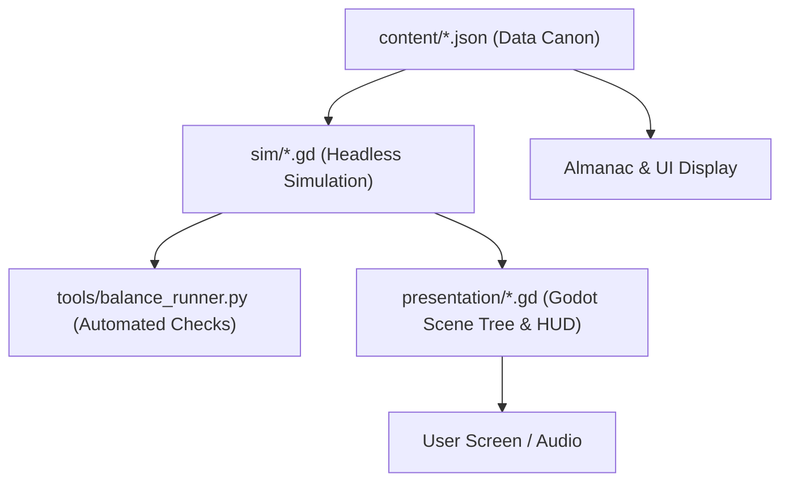

# SPEC 11: Technical Architecture, Save Formats & Build Order

## 1. Engine & Architectural Separation

Clowder is engineered in **Godot 4.3** with GDScript, adhering strictly to a decoupled model-view architecture:



### Simulation Core (`sim/`)
- Pure GDScript classes inheriting `RefCounted`.
- **Zero Scene Tree Calls**: Forbidden from calling `get_node()`, `Node`, `add_child()`, `Tree`, or loading textures.
- **Deterministic**: Controlled via seeded PRNG counters. No wall-clock dependencies (`Time.get_ticks_msec()` or `OS` calls are forbidden inside simulation logic).
- Runs at a fixed **30 Hz tick rate**.

### Content Data (`content/`)
- All balancing parameters, upgrade costs, round definitions, enemy stats, and shop items exist exclusively as external JSON documents.
- Numbers are never hardcoded into simulation or UI scripts.

### Presentation Layer (`presentation/`)
- Godot 2D scenes (`.tscn`), shaders, particles, audio buses, and UI control nodes.
- Reads simulation state and renders visually with interpolated positions.
- Handles user input and issues action commands to the simulation.

---

## 2. Directory Layout

```text
TD_game/
├── content/               # Authoritative JSON content
│   ├── cats/*.json        # 8 launch cat definition files
│   ├── heroes/*.json      # 4 hero definition files
│   ├── maps/*.json        # Map geometries and mask definitions
│   ├── rounds/*.json      # Wave compositions (sunny.json, bands.json)
│   ├── insights.json      # Passive trees data
│   ├── levels.json        # Account level-up curves and unlocks
│   ├── mice.json          # 12 mouse coat stats and hierarchy
│   ├── rats.json          # 5 rat boss stats and death spawns
│   ├── shop.json          # Cosmetic catalog and pricing
│   └── tricks.json        # 8 tricks with cooldowns and costs
├── sim/                   # Headless simulation engine
│   ├── constants.gd       # Damage types, masks, global constants
│   ├── economy.gd         # Kibble, discounts, and selling calculations
│   ├── feats.gd           # Feat XP tracking and seeded card drafting
│   ├── hero.gd            # Hero instance leveling and active abilities
│   ├── match.gd           # Core match state machine (30 Hz tick loop)
│   ├── projectile.gd      # Projectile physics, homing, and hit registration
│   ├── replay.gd          # Deterministic action logging and reproduction
│   ├── status.gd          # Freeze, burn, stun, and Matriarch immunity
│   ├── tower.gd           # Cat placement, range, targeting, and upgrade logic
│   └── unit.gd            # Enemy movement along path and pop resolution
├── presentation/          # Godot scene, drawing, and UI
│   ├── art/               # Sprites, tiles, props, and import configs
│   ├── main.gd            # Main presentation coordinator and HUD logic
│   └── main.tscn          # Primary game viewport scene
├── SPEC/                  # Authoritative design and technical specifications
├── tools/                 # Headless balance runners and extraction scripts
│   ├── balance_runner.py  # 9 Automated balance validation checks
│   ├── sunny_scripted_match.py # Acceptance test for Sunny rounds 1-10
│   └── extract_art.py     # Sprite sheet asset extraction utility
├── project.godot          # Godot 4 project configuration
└── package.json           # Node / npm development workflow scripts
```

---

## 3. Save Game Architecture & Profile Schema

Profiles are stored in a single JSON document with an appended checksum to guard against incomplete writes or file corruption:

```json
{
  "version": 1,
  "checksum": "sha256_hash_of_payload",
  "payload": {
    "account": {
      "level": 10,
      "xp": 2550,
      "insight_points": 10,
      "insight_purchases": ["alley_extra_kibble", "clowder_keen_wallet"]
    },
    "economy": {
      "fishcoin": 185,
      "owned_shop_ids": ["pip_red_collar", "trick_tuna_strike"]
    },
    "mastery": {
      "pip": 12450,
      "nibs": 8300,
      "pudding": 3200
    },
    "medals": {
      "sunny_gutter": {
        "sunny": true,
        "alley": false,
        "night": false,
        "last_whisker": false,
        "bare_paw": false,
        "alternate_warrens": false,
        "full_nets": false,
        "short_leash": false
      }
    },
    "unlock_queue": [],
    "settings": {
      "speed": 2,
      "auto_start": false,
      "screen_shake": "low",
      "vfx_reduced": false,
      "text_scale": 100,
      "colorblind_shapes": true
    },
    "current_match": null
  }
}
```

---

## 4. Replay System & Deterministic Logging

A replay file records the match seed and an array of discrete player actions:

$$\text{Replay} = \{\text{seed: int, mode: string, map: string, actions: Array[Action]}\}$$

An individual action record is structured as:
```json
{
  "tick": 1420,
  "type": "place_cat",
  "payload": {
    "cat_id": "pip",
    "position": [240, 180],
    "instance_id": 1
  }
}
```

### Action Types:
`place_cat`, `upgrade_cat`, `sell_cat`, `set_targeting`, `use_hero_ability`, `use_trick`, `select_feat`, `reroll_feat`, `set_speed`, `start_round`.

Given the seed, map, and action stream, the headless simulation reproduces the exact outcome of the match tick-for-tick.

---

## 5. Automated Balance Runner Checks (9 Test Gates)

Before committing code or submitting a release build, the test runner (`npm test`) executes headless validation across all 9 gates:

1. **Hierarchy & RBE Gate**: RBE calculations, coat layers, and child spawns match spec tables 100%.
2. **Matriarch Immunity Gate**: The Rat Matriarch completely ignores stun, knockback, freeze, and slow.
3. **Trick Ceiling Gate**: No trick deals >1100 damage to the Rat Matriarch or skips a round.
4. **Discount Floor Gate**: Upgrade discounts do not stack and never drop prices below 60% of base.
5. **Gnaw Suppression Gate**: Gnaw cannot regrow while speed is under 80% and caps at 3 regrows.
6. **Pop Overflow Gate**: Projectile damage overflow recursively cascades into the first child without consuming extra pierce.
7. **Goldie Payback Gate**: A 2-0-0 Goldie returns its cost within 7 to 10 rounds on Alley mode.
8. **Feat Stability Gate**: Feat card draft offers for a given seed and cat instance are 100% stable across runs.
9. **Account XP Progression Gate**: A fresh clear of Sunny rounds 1–40 awards exactly 2440 XP and lands on Account Level 10.

---

## 6. Build Order (Phases 1–13)

1. **Phase 1: Greybox Sim**: Path follower, Rust mice, single Pip, lives tracking, 30 Hz tick loop.
2. **Phase 2: Pop Law**: All 7 damage types, nested children, overflow recursion, immunities matrix.
3. **Phase 3: Sunny 1–40 & Starter Cats**: Pip, Nibs, Pudding, Biscuit with crosspaths through Tier 2.
4. **Phase 4: The Burrow Rat & Results**: Round 40 boss encounter, results screen, Sunny medal.
5. **Phase 5: Roster Expansion**: Sable, Nim, Goldie, Miso implemented with Tiers 3–5.
6. **Phase 6: Heroes**: Mittens (Levels 1–20), followed by Duchess, Baron Salt, and Sister Pebble.
7. **Phase 7: Mastery Locks**: Meta Mastery XP accumulation and tier unlocking activated.
8. **Phase 8: In-Match Feats**: Between-round drafted feat cards, seeded rolls, and reroll mechanics.
9. **Phase 9: Account XP & Insights**: Account leveling curve, unlock queue, and 6 Insight trees.
10. **Phase 10: Fishcoin & Shop**: Shop catalog, 8 tactical Tricks, cosmetics, daily/weekly modes.
11. **Phase 11: Maps & Modifiers**: Remaining 5 maps, difficulty modes (Alley, Night, Last Whisker, Bare Paw), 3 modifiers.
12. **Phase 12: Polish, Audio & Almanac**: Dynamic pop pitch escalation, UI wood theme, and Almanac encyclopedias.
13. **Phase 13: Final Test Gates**: Headless verification of all 9 balance gates; release readiness.

---

## 7. Scope Boundaries (Strictly Post-v1)

The following features are explicitly excluded from v1:
- Real-money purchases, ads, paid continues, or premium currency.
- Co-op multiplayer.
- Alpha Cats (sacrificial synthesis).
- Boss events, raid races, user-generated custom maps.
- Mobile touch controls or controller-first navigation.
- Additional languages (English first).
- Mid-round feat draft pauses.
- Random Fishcoin drops.

