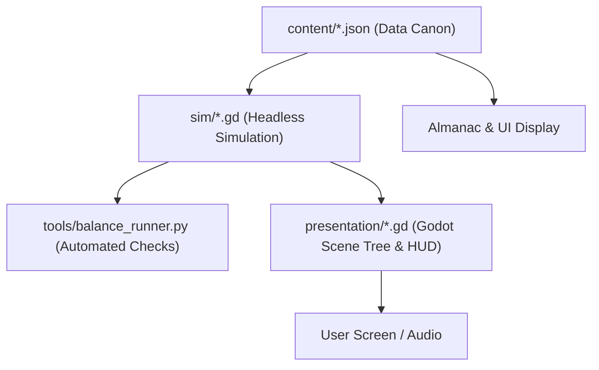

# SPEC 11: Technical Architecture, Save Formats & Build Order

## 1. Engine & Architectural Separation

Clowder is engineered in **Godot 4.3** with GDScript, adhering strictly to a decoupled model-view architecture:



### Simulation Core (`sim/`)
- Pure GDScript classes inheriting `RefCounted`.
- **Zero Scene Tree Calls**: Forbidden from calling `get_node()`, `Node`, `add_child()`, `Tree`, or loading textures.
- **Deterministic**: Controlled via seeded PRNG counters. No wall-clock dependencies (`Time.get_ticks_msec()` or `OS` calls are forbidden inside simulation logic).
- Runs at a fixed **30 Hz tick rate**.

### Content Data (`content/`)
- All balancing parameters, upgrade costs, round definitions, enemy stats, and shop items exist exclusively as external JSON documents.
- Numbers are never hardcoded into simulation or UI scripts.

### Presentation Layer (`presentation/`)
- Godot 2D scenes (`.tscn`), shaders, particles, audio buses, and UI control nodes.
- Reads simulation state and renders visually with interpolated positions.
- Handles user input and issues action commands to the simulation.

---

## 2. Directory Layout

```text
TD_game/
├── content/               # Authoritative JSON content
│   ├── cats/*.json        # 8 launch cat definition files
│   ├── heroes/*.json      # 4 hero definition files
│   ├── maps/*.json        # Map geometries and mask definitions
│   ├── rounds/*.json      # Wave compositions (sunny.json, bands.json)
│   ├── insights.json      # Passive trees data
│   ├── levels.json        # Account level-up curves and unlocks
│   ├── mice.json          # 12 mouse coat stats and hierarchy
│   ├── rats.json          # 5 rat boss stats and death spawns
│   ├── shop.json          # Cosmetic catalog and pricing
│   └── tricks.json        # 8 tricks with cooldowns and costs
├── sim/                   # Headless simulation engine
│   ├── constants.gd       # Damage types, masks, global constants
│   ├── economy.gd         # Kibble, discounts, and selling calculations
│   ├── feats.gd           # Feat XP tracking and seeded card drafting
│   ├── hero.gd            # Hero instance leveling and active abilities
│   ├── match.gd           # Core match state machine (30 Hz tick loop)
│   ├── projectile.gd      # Projectile physics, homing, and hit registration
│   ├── replay.gd          # Deterministic action logging and reproduction
│   ├── status.gd          # Freeze, burn, stun, and Matriarch immunity
│   ├── tower.gd           # Cat placement, range, targeting, and upgrade logic
│   └── unit.gd            # Enemy movement along path and pop resolution
├── presentation/          # Godot scene, drawing, and UI
│   ├── art/               # Sprites, tiles, props, and import configs
│   ├── main.gd            # Main presentation coordinator and HUD logic
│   └── main.tscn          # Primary game viewport scene
├── SPEC/                  # Authoritative design and technical specifications
├── tools/                 # Headless balance runners and extraction scripts
│   ├── balance_runner.py  # 9 Automated balance validation checks
│   ├── sunny_scripted_match.py # Acceptance test for Sunny rounds 1-10
│   └── extract_art.py     # Sprite sheet asset extraction utility
├── project.godot          # Godot 4 project configuration
└── package.json           # Node / npm development workflow scripts
```

---

## 3. Save Game Architecture & Profile Schema

Profiles are stored in a single JSON document with an appended checksum to guard against incomplete writes or file corruption:

```json
{
  "version": 1,
  "checksum": "sha256_hash_of_payload",
  "payload": {
    "account": {
      "level": 10,
      "xp": 2550,
      "insight_points": 10,
      "insight_purchases": ["alley_extra_kibble", "clowder_keen_wallet"]
    },
    "economy": {
      "fishcoin": 185,
      "owned_shop_ids": ["pip_red_collar", "trick_tuna_strike"]
    },
    "mastery": {
      "pip": 12450,
      "nibs": 8300,
      "pudding": 3200
    },
    "medals": {
      "sunny_gutter": {
        "sunny": true,
        "alley": false,
        "night": false,
        "last_whisker": false,
        "bare_paw": false,
        "alternate_warrens": false,
        "full_nets": false,
        "short_leash": false
      }
    },
    "unlock_queue": [],
    "settings": {
      "speed": 2,
      "auto_start": false,
      "screen_shake": "low",
      "vfx_reduced": false,
      "text_scale": 100,
      "colorblind_shapes": true
    },
    "current_match": null
  }
}
```

---

## 4. Replay System & Deterministic Logging

A replay file records the match seed and an array of discrete player actions:

$$\text{Replay} = \{\text{seed: int, mode: string, map: string, actions: Array[Action]}\}$$

An individual action record is structured as:
```json
{
  "tick": 1420,
  "type": "place_cat",
  "payload": {
    "cat_id": "pip",
    "position": [240, 180],
    "instance_id": 1
  }
}
```

### Action Types:
`place_cat`, `upgrade_cat`, `sell_cat`, `set_targeting`, `use_hero_ability`, `use_trick`, `select_feat`, `reroll_feat`, `set_speed`, `start_round`.

Given the seed, map, and action stream, the headless simulation reproduces the exact outcome of the match tick-for-tick.

---

## 5. Automated Balance Runner Checks (9 Test Gates)

Before committing code or submitting a release build, the test runner (`npm test`) executes headless validation across all 9 gates:

1. **Hierarchy & RBE Gate**: RBE calculations, coat layers, and child spawns match spec tables 100%.
2. **Matriarch Immunity Gate**: The Rat Matriarch completely ignores stun, knockback, freeze, and slow.
3. **Trick Ceiling Gate**: No trick deals >1100 damage to the Rat Matriarch or skips a round.
4. **Discount Floor Gate**: Upgrade discounts do not stack and never drop prices below 60% of base.
5. **Gnaw Suppression Gate**: Gnaw cannot regrow while speed is under 80% and caps at 3 regrows.
6. **Pop Overflow Gate**: Projectile damage overflow recursively cascades into the first child without consuming extra pierce.
7. **Goldie Payback Gate**: A 2-0-0 Goldie returns its cost within 7 to 10 rounds on Alley mode.
8. **Feat Stability Gate**: Feat card draft offers for a given seed and cat instance are 100% stable across runs.
9. **Account XP Progression Gate**: A fresh clear of Sunny rounds 1–40 awards exactly 2440 XP and lands on Account Level 10.

---

## 6. Build Order (Phases 1–13)

1. **Phase 1: Greybox Sim**: Path follower, Rust mice, single Pip, lives tracking, 30 Hz tick loop.
2. **Phase 2: Pop Law**: All 7 damage types, nested children, overflow recursion, immunities matrix.
3. **Phase 3: Sunny 1–40 & Starter Cats**: Pip, Nibs, Pudding, Biscuit with crosspaths through Tier 2.
4. **Phase 4: The Burrow Rat & Results**: Round 40 boss encounter, results screen, Sunny medal.
5. **Phase 5: Roster Expansion**: Sable, Nim, Goldie, Miso implemented with Tiers 3–5.
6. **Phase 6: Heroes**: Mittens (Levels 1–20), followed by Duchess, Baron Salt, and Sister Pebble.
7. **Phase 7: Mastery Locks**: Meta Mastery XP accumulation and tier unlocking activated.
8. **Phase 8: In-Match Feats**: Between-round drafted feat cards, seeded rolls, and reroll mechanics.
9. **Phase 9: Account XP & Insights**: Account leveling curve, unlock queue, and 6 Insight trees.
10. **Phase 10: Fishcoin & Shop**: Shop catalog, 8 tactical Tricks, cosmetics, daily/weekly modes.
11. **Phase 11: Maps & Modifiers**: Remaining 5 maps, difficulty modes (Alley, Night, Last Whisker, Bare Paw), 3 modifiers.
12. **Phase 12: Polish, Audio & Almanac**: Dynamic pop pitch escalation, UI wood theme, and Almanac encyclopedias.
13. **Phase 13: Final Test Gates**: Headless verification of all 9 balance gates; release readiness.

---

## 7. Scope Boundaries (Strictly Post-v1)

The following features are explicitly excluded from v1:
- Real-money purchases, ads, paid continues, or premium currency.
- Co-op multiplayer.
- Alpha Cats (sacrificial synthesis).
- Boss events, raid races, user-generated custom maps.
- Mobile touch controls or controller-first navigation.
- Additional languages (English first).
- Mid-round feat draft pauses.
- Random Fishcoin drops.


## 8. Post-v1 expansion interfaces (proposed)

These interfaces support the unratified [SPEC 13](13_GRAND_EXPANSION_SYSTEMS.md). They do not enable multiplayer, change v1 saves, or establish that cross-platform determinism has been achieved. Existing replay and profile formats remain valid; an implementation requires explicit versioned migrations and compatibility tests.

### Lockstep frames and snapshots

A session handshake compares protocol, sim build, ruleset, map revision, content digest, seed, player roster and negotiated input delay. Refuse a mismatch. Authentication and transport are separate from simulation; TLS or equivalent, identity, NAT traversal and relay support require a separate threat model. No peer may submit actions as another player.

```json
{
  "protocol_version": 1,
  "player_id": 0,
  "tick": 1420,
  "actions": [{"sequence": 0, "type": "place_cat", "payload": {"cat_id": "pip", "position": [240, 180]}}],
  "checksum_tick": 1410,
  "state_checksum": "sha256-of-canonical-state-at-checksum-tick"
}
```

A frame covers exactly one player and tick; empty `actions` means no action, not missing input. Sequences are nonnegative, unique and strictly increasing within the frame. Validate lengths, types, bounds, identity and permitted action types before accepting; retransmission of identical frames is idempotent, while conflicting frames abort the session. All players advance only after receiving every frame for that tick, sorted by player ID then sequence. Sim validates costs, ownership, placement and phase; an invalid action has a deterministic no-op result. Instance IDs are assigned by the sim, never trusted from the network. Speed controls are local presentation; pause and round-start votes are synchronized actions.

The checksum describes the complete authoritative state *after* `checksum_tick`, not the future input frame. Hash a canonical byte serialization with specified integer widths, ordering, PRNG state, content identity and all future-affecting state; exclude rendering and wall-clock data. JSON key order and platform-dependent float formatting are not a canonical encoding. Hash periodically at a protocol-defined interval and compare identical ticks. A mismatch pauses and records diagnostics, never silently continues. Recovery uses a mutually verified snapshot at an agreed tick plus the ordered frames after it; reject mismatched versions or hash. Cap frame, snapshot and history sizes. Cross-platform numeric behavior and PRNG must be audited and tested before lockstep is enabled; fixed ticks alone do not ensure determinism.

### Map export envelope

This proposed interchange envelope is independent of the current runtime map format and requires an explicit validated adapter. Coordinates are integer map units; arrays preserve authored order and IDs are unique within their collection.

```json
{
  "schema_version": 1, "id": "custom_example", "name": "Example",
  "bounds": [680, 480],
  "paths": [{"id": "main", "points": [[40, 100], [640, 100], [640, 400]]}],
  "masks": [{"id": "yard", "kind": "land", "polygon": [[0, 0], [680, 0], [680, 480], [0, 480]]}],
  "blockers": [], "props": []
}
```

Kinds are `land`, `water`, or `perch`; blockers are separately identified bounded polygons and take precedence over placement masks. Paths need at least two distinct consecutive points; reject zero-length segments, out-of-bounds coordinates, invalid or self-intersecting polygons, unknown fields or IDs and excessive counts or payload sizes according to published limits. A map must have a reachable exit and placement-clear track ribbon; multi-path routing and overlaps use the existing map rules. Props reference bundled allowlisted art IDs and integer positions and have no collision without a blocker. The editor and import validator share rules. Share-code encoding, compression format and exact size limits must be versioned and specified before implementation; checksum is corruption detection, not a security boundary.

### Dialogue script envelope

```json
{
  "schema_version": 1, "id": "burrow_intro",
  "trigger": {"event": "before_boss", "boss_id": "burrow"},
  "lines": [{"speaker": "mittens", "emotion": "alert", "line": "The pier needs us.", "sfx": null}]
}
```

IDs resolve only to bundled content; line is plain display text and optional SFX is an allowlisted ID or null. Bound line count and length. Trigger occurs at a defined simulation event; display and dismissal do not pause, mutate or sample the simulation. Localization and subtitles can substitute presentation text while preserving script IDs.

### Ledger profile extension

This is a candidate extension inside the checksummed profile `payload`; bump the profile version and migrate old profiles with an empty ledger when implemented.

```json
{
  "active_track_id": "harvest_01",
  "tracks": {
    "harvest_01": {"ledger_xp": 1200, "claimed_tiers": [1, 2], "applied_result_ids": ["match-unique-id"]}
  }
}
```

Ledger XP is a nonnegative integer copy of eligible Account XP, not a subtraction or additional Account XP grant. Thresholds and the 50 tier rewards live in versioned content. Track IDs, claimed tier integers 1?50 and result IDs are unique; a claim must be eligible and atomically grant its reward exactly once. Result IDs must be stable across retries and reconnects. Archive progression and outstanding claims persist after the published season ends; switching tracks cannot duplicate XP or rewards. Save migrations and atomic writes must preserve existing currencies and unlocks. Offline calendar reconciliation and bounded durable deduplication need a specified design before release.
